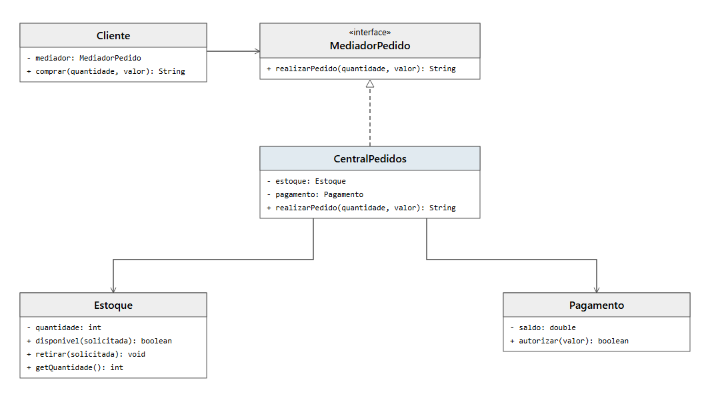

# DCC078 - Padrões de Projeto: Mediator

**Aluno:** Felipe Lazzarini Cunha

## Tema

O projeto representa a confirmação de pedidos em uma loja. Uma central intermedeia a comunicação entre o cliente, o estoque e o pagamento, coordenando as verificações necessárias. A autorização do pagamento é simulada por uma comparação com o saldo disponível.

## Diagrama de Classes UML



## Estrutura do Projeto

- `MediadorPedido`: interface para encaminhar pedidos.
- `CentralPedidos`: mediador que coordena estoque e pagamento.
- `Cliente`: solicita a compra por meio do mediador.
- `Estoque`: verifica e atualiza a quantidade disponível.
- `Pagamento`: simula a autorização de um pagamento.

## Testes

Com JDK 11 ou superior e Maven:

```bash
mvn test
```
